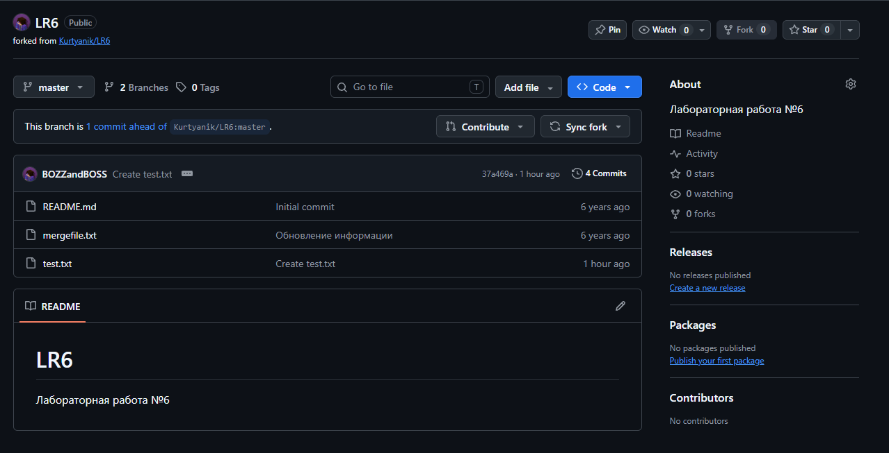
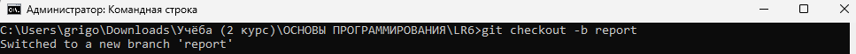

# Лабораторная работа №6. Система контроля версий
**Выполнил:** студент группы 4516 Гречаный Г. П.

## Цель работы
изучение базовых возможностей системы управления версиями, опыт работы с Git Api, опыт работы с локальным и удаленным репозиторием. 

## Ход выполнения работы

### 1. Настройка Git, клонирование репозитория и файл через интерфейс GitHub
Был создан аккаунт на GitHub, сделан Fork исходного репозитория (убрана галочка с пункта "копировать только основную ветку"). Скачан Git с оффициального сайта, локально настроены имя пользователя и почта в консоли, после чего репозиторий склонирован на ПК. Затем через GitHub добавил новый файл test.txt и подтянул изменения в локальный репозиторий командой git pull origin master

### 2. История веток и последние изменения

Переключаясь между ветками и вводя команды git log и git show, получил логи и последние изменения соответственно.

### 3. Слияние и конфликт

При попытке слияния branch1 в master возник конфликт в файле mergefile.txt: обе ветки изменили одни и те же строки. Конфликт был разрешён в редакторе Notepad++, после чего сделан коммит слияния. Побочная ветка branch1 удалена.

### 4. Коммиты и откат
В созданный ранее файл test.txt трижды вносились изменения с отдельными коммитами. Последний коммит отменён командой git revert --no-edit HEAD. Для отчёта была создана ветка report.

### Лог команд

git config --global user.name "4516 Гречаный Г. П."
git config --global user.email "grigory.grechany@gmail.com"
cd "C:\Users\grigo\Downloads\Учёба (2 курс)\ОСНОВЫ ПРОГРАММИРОВАНИЯ"
git clone https://github.com/BOZZandBOSS/LR6.git
cd LR6
git pull origin master
git branch -a
git log
git checkout branch1
git log
git status
git show
git checkout master
git status
git show
git merge branch1
git add .
git commit -m "Разрешил конфликт при слиянии"
git branch -d branch1
git commit -am "первое изменение"
git commit -am "второе изменение"
git commit -am "третье изменение"
git revert --no-edit HEAD
git checkout -b report
git add screenshots
git commit -m "Добавил папку со скриншотами"
git add README.md
git commit -m "Оформил основную часть отчета и добавил скриншоты"
git log --pretty=format:"%h - %ad, %an : %s" --date=short
git add README.md
git commit -m "Добавил лог команд и историю операций, финальная версия отчета"
git push origin report

### История операций

Команда git log --pretty=format:"%h - %ad, %an : %s" --date=short вывела:

7c36476 - 2026-11-11, 4516 Гречаный Г. П. : Оформил основную часть отчета и добавил скриншоты
260360c - 2026-11-11, 4516 Гречаный Г. П. : Добавил новый скриншот в папку
d550f7f - 2026-11-11, 4516 Гречаный Г. П. : Добавил папку со скриншотами
b27eecf - 2026-11-11, 4516 Гречаный Г. П. : Revert "третье изменение"
548885a - 2026-11-11, 4516 Гречаный Г. П. : третье изменение
ece28b2 - 2026-11-11, 4516 Гречаный Г. П. : второе изменение
065de40 - 2026-11-11, 4516 Гречаный Г. П. : первое изменение
4862daa - 2026-11-11, 4516 Гречаный Г. П. : Разрешил конфликт при слиянии
37a469a - 2026-11-11, BOZZ : Create test.txt
921f53b - 2020-11-21, Kurtyanik : Обновление информации
0f9f50d - 2020-11-21, Kurtyanik : Заполнил файл
c08a654 - 2020-11-21, Kurtyanik : Файл создан пустым
3c6e913 - 2020-11-21, Kurtyanik : Initial commit
